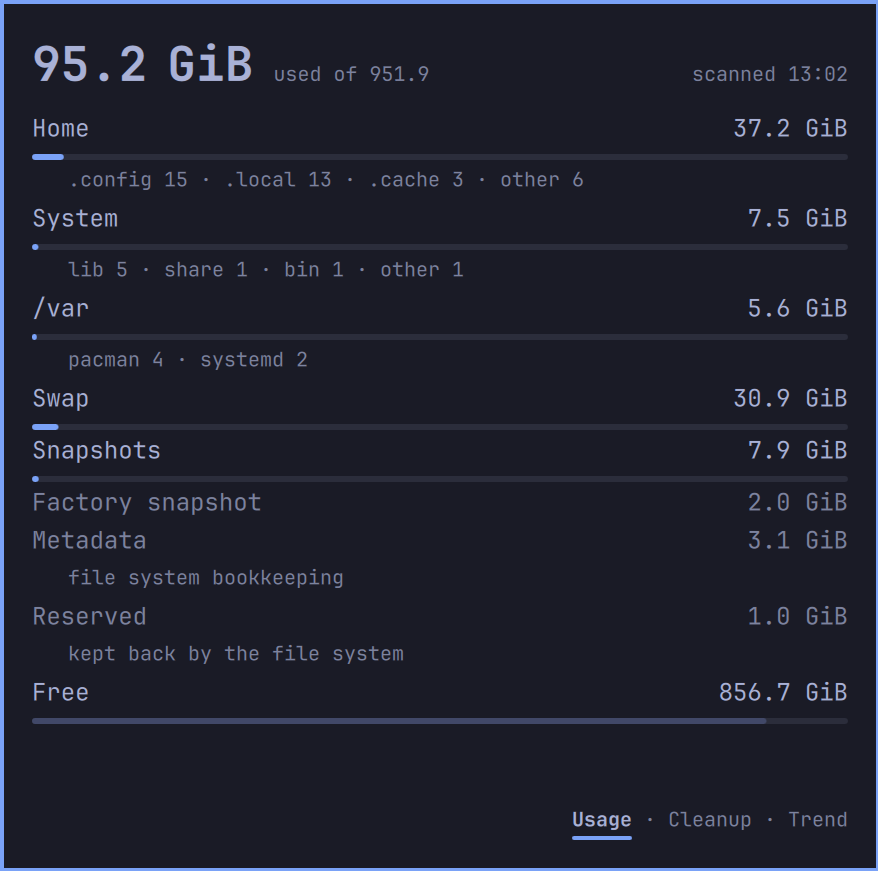

# Kanso Disk Space

Free space on `/` for Omarchy's bar, measured exactly the way `omarchy update`
gates on it: what's free, where the space went, what you can safely clean, and
when you'll run low. Quiet until it matters. Every size is measured, never
estimated.



## What it shows

- **The bar**: a drive glyph in the text colour. From Watch it adds the free
  space in whole GiB ("45G"), from Low it turns yellow, at Critical and when
  updates are blocked it turns red.
- **Hover**: free space, the whole disk as one bar, any warning, the trend,
  the three biggest uses and what you could reclaim. When used space moved by
  1 GiB or more since you last looked, a line says what changed.
- **Click**: the full view, **Usage · Cleanup · Trend**. From Low it opens on
  Cleanup.
  - **Usage**: where every byte is, one decimal everywhere, and the rows add up
    to the disk as shown: Home, System, /var, Swap, Snapshots, Metadata
    ("file system bookkeeping"), Reserved ("kept back by the file system"),
    Free.
  - **Cleanup**: what you can free. Each row says whether deleting it frees
    space now or only after updates, once your rollback snapshots rotate.
    Snapshots are shown as rollback points and never counted as reclaimable.
    Besides app caches, the package cache, old mise versions, logs, Downloads
    and the Trash, it finds developer caches outside `~/.cache` (npm, pnpm,
    Bun, Go modules, Rust toolchains, the Cargo registry) and Electron apps'
    caches in `~/.config`. An open app's caches are measured and counted, and
    the row says "close Claude first": they are cleaned only once the app is
    closed.
  - **Trend**: free space over 90 days and a forecast written as a range
    ("Critical in 9–14 days"). For its first days it says when it will be
    ready ("ready in 4 days").
- **Warnings** show under each page's hero, with at most two links: *What now
  ›* opens a short panel of steps (with Copy beside each command), *Ask agent
  ›* hands the job to your coding agent, *Rescan ›* measures again, *Why ›*
  and *How to fix ›* open this file at the section that explains.
- **After a cleanup**, Cleanup's footer is a receipt: "Last cleanup today · 9.8
  of 12.4 GiB freed", and, when it freed less than expected, why (held by
  rollback points, waiting in the Trash).
- **Notifications**: when the level gets worse (Low, Critical, updates
  blocked), when the forecast reaches Critical within your horizon, when the
  disk fills fast, and when the disk turns read-only. Clicking one opens the
  card on Cleanup (read-only: its What now panel). Fast filling and read-only
  show through Do Not Disturb.
- **Right-click**: Ask agent · Copy report · Save report (to `~/Documents`),
  and Remove exact sizes while the helper is installed.

The plugin never deletes anything. Cleaning is your agent's job, under
`agents/skills/disk-cleanup/SKILL.md`: it asks before each category, runs a
dry run first, hands you every `sudo` command to run yourself, and logs what it
freed so the card can show the receipt. *Ask agent* opens Omarchy's default
agent (Claude Code in plan mode) with the report and the skill.

## Install

```
omarchy plugin add https://github.com/nathankramm/omarchy-kanso-disk-space
```

## Settings

The widget's settings (Omarchy's bar settings for this widget):

- **Watch / Low / Critical below (GiB)**: the three lines, 50 · 30 · 15 by
  default. They must fall, Watch above Low above Critical above 10 GiB (the
  update gate, Omarchy's own line and not a setting). If they do not, the
  card says "Level settings are out of order" and uses the default for every
  setting but totals only until you fix them: open the bar's settings for
  Kanso Disk Space and set each line below the one before it.
- **Warn when Critical is this many days away**: the forecast's horizon, 14 by
  default.
- **Notifications**: every notification but read-only, which always shows.
- **Show free GiB on the bar**: the number beside the glyph, from Watch.
- **Agent report: totals only**: off by default. When on, the report (Ask
  agent, Copy report, Save report) keeps each category's total and its
  official commands, and names no folder or file inside the categories:
  meant for an agent that runs in the cloud. The report's header and the Ask
  agent prompt both say which mode you are in, and so does the Cleanup tab.

## Exact sizes

Free space, the levels, the forecast and every notification come from
`statvfs` and are always exact. Sizes inside the disk are shown only where
something measured them exactly; anything not measured reads "—", never a
guess.

- **ext4**: the plugin's own walk, no setup.
- **btrfs** (Omarchy's default): compression, reflinks and snapshots make a
  folder's size different from what deleting it frees, and only root can
  read the true figures. The first click offers **Set up**. It opens
  Omarchy's password dialog (you need to be in `wheel`) and installs
  `compsize`, `btrfs-progs` and `python` with pacman (`--needed`), a small
  read-only helper at `/usr/local/libexec/kanso-disk-measure` (root-owned,
  0755), and one sudo rule, `/etc/sudoers.d/kanso-disk-measure`, for exactly
  that path with no arguments. Until then the card shows free space, the
  levels and the trend.
- **Other filesystems**: free space, the levels and the trend.

The helper only reads, at low priority. It measures only the folders the
plugin asks about, never follows a symlink or reads another user's files, and
refuses to run if the plugin is removed or its copy of the helper differs.
When a plugin update changes the helper, the card asks you to **Update** it
with the same dialog. It refuses in a few more situations, and the card says
which.

The daily scan takes about a minute on an NVMe SSD; while it measures, the
card says "Measuring exact sizes", including the first time right after
setup. If the disk is too slow to measure in time, the card says so and keeps
the last good sizes; free space and the warnings stay exact.

## Other login users

With the helper, the card needs a single-user machine: if another login user
exists (any account with a real shell), or another user's folder sits in
`/home`, the helper measures nothing exact and the card shows only free space,
the bar, the levels and the trend.

Why: the helper runs as root, and the measuring tool (compsize) walks folders
by path. Another user could swap a folder for a link while it walks and learn
the size of files they cannot read. Refusing is the only safe answer; it is
not a fault you need to fix. Removing an account you no longer use, or moving
another user's folder out of `/home`, brings exact sizes back at the next scan.

## Symlinked plugin folder

The helper measures nothing unless your installed plugin holds a copy of it,
and it never follows a symbolic link to find that copy. If a dotfiles tool
such as GNU Stow links `~/.config`, `~/.config/omarchy` or the plugins folder
into place, the card says "Exact sizes off: the plugin folder is behind a
symlink".

How to fix: keep `~/.config/omarchy/plugins` out of stow, as a real folder.

1. Unstow the package that holds it (for example `stow -D omarchy` from your
   dotfiles folder), or tell stow to skip it (an `.stow-local-ignore` entry
   for `plugins`), so `~/.config/omarchy/plugins` is a real folder again.
2. Reinstall the plugin there with Omarchy's plugin manager.
3. Click Rescan in the card.

## Read-only disk

If `/` or `/home` turns read-only, the kernel has usually stopped writes after
an error. Your files are safe to read. Save open work to another drive (a USB
stick), then restart. *Copy details* in the What now panel puts the kernel's
own lines about the disk on the clipboard, for whoever checks it. *Ask agent*
is offered only while `/home` can still be written (its report lives there),
and the agent then diagnoses with read-only commands only: it never repairs,
remounts or deletes, and asks you to back up first.

On Omarchy's default layout `/` and `/home` are subvolumes of one btrfs
filesystem, so an error makes both read-only together and Ask agent is not
offered; it appears only when `/` alone is read-only (a read-only bind or a
separate `/home` filesystem).

## /boot nearly full

When `/boot` is its own partition and reaches 85 % full, limine-snapper-sync
adds no boot entry for a new snapshot. Nothing breaks today. List the boot
entries with `sudo limine-snapper-list`, then remove the oldest with
`sudo limine-snapper-remove <ID>`; *Ask agent* does the same with you, one
entry at a time, and hands you every sudo command.

## Remove

1. Right-click the drive icon → **Remove exact sizes** (removes the helper and
   its sudo rule; asks for your password).
2. `omarchy plugin remove io.github.nathankramm.kanso-disk-space`

Already removed the plugin first? Remove the helper and rule with:

```
sudo rm /etc/sudoers.d/kanso-disk-measure /usr/local/libexec/kanso-disk-measure
```

`compsize` stays installed; remove it with `sudo pacman -Rs compsize` if
nothing else uses it.

Then delete the plugin's own files: its state (samples, scans, the reports
Ask agent writes) and `protect.json` (folders the report never offers):

```
rm -rf ~/.local/state/kanso-disk-space/ ~/.config/omarchy/kanso-disk-space/
```

Reports you saved with Save report stay in `~/Documents` (`disk-space-*.md`);
the read-only marker in `$XDG_RUNTIME_DIR` goes at logout.

## Privacy

Everything stays on your machine: the state lives in
`~/.local/state/kanso-disk-space/`, and the report is written only when you
ask for it. Only Set up downloads anything (pacman). When you click Ask agent,
your agent reads the report, folder and file names included, under that
agent's own terms; turn on **Agent report: totals only** to leave the names
out. Names are treated as data, never as instructions: they are escaped, the
agent is told never to follow text found in them, and names with unusual
characters are listed but never offered for cleaning. Every cleanup command
that names a path uses its absolute path: no `~`, no wildcards.

## Limitations

- Exact sizes switch off while another login user exists (see above).
- Tested on Omarchy's standard btrfs layout; other layouts are less tested.
- English only.

## Development

Tests, the oracle and its mutation run live in a separate development
repository. Each release is copied from there into this repository as one
commit.

## License

MIT, see [LICENSE](LICENSE).
